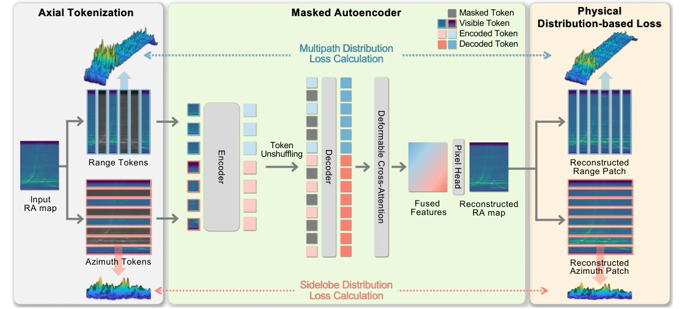
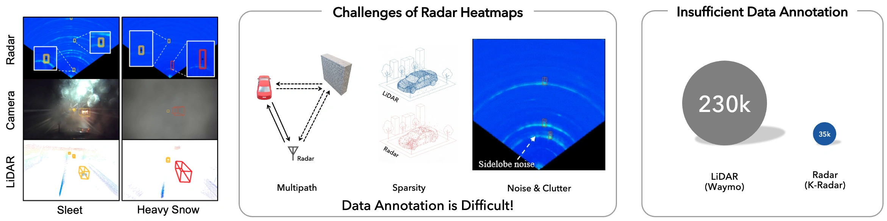
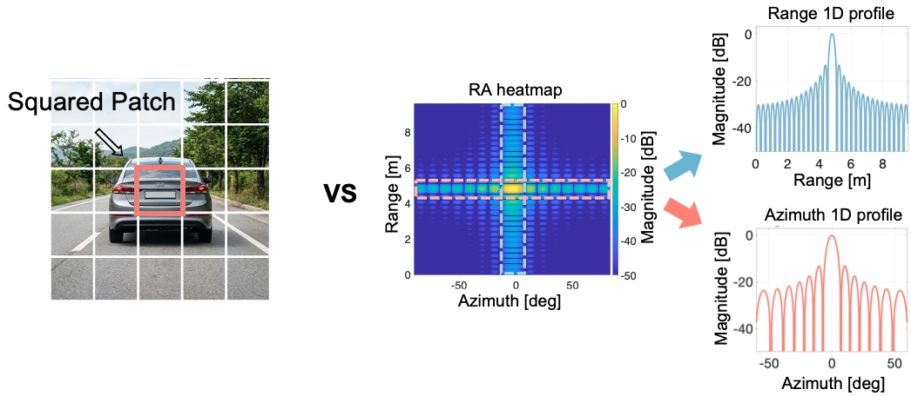
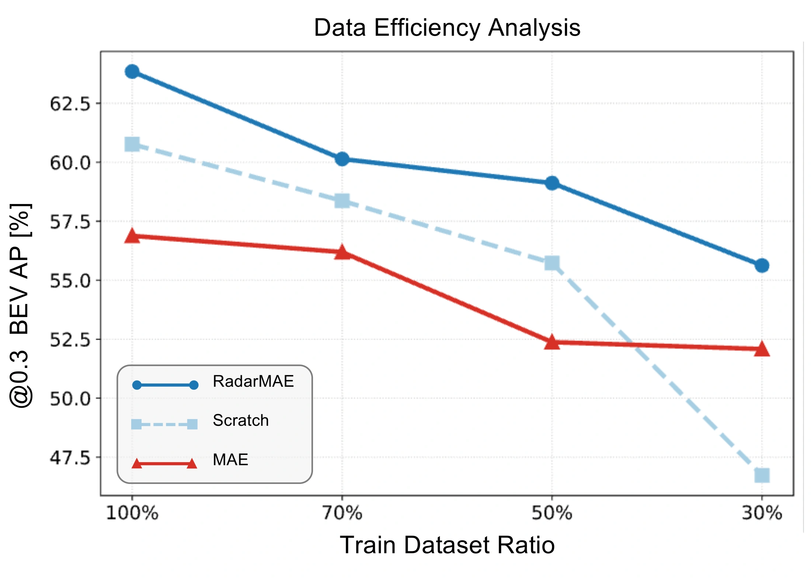
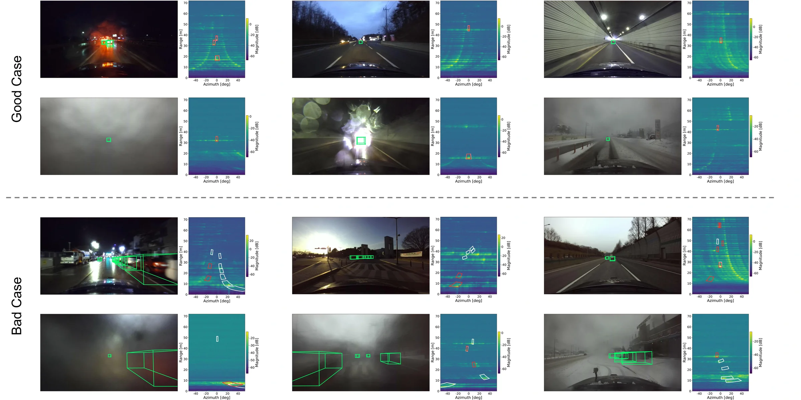

# RadarMAE: Injecting Physical Inductive Biases into Masked Autoencoders for Advanced Radar Object Detection

<div align="center">

**[Eunchan Kim](mailto:eunchan.kim@dgist.ac.kr)<sup>1</sup>**, **[Jeongwan Shin](mailto:jwshin@dgist.ac.kr)<sup>1,2</sup>**, **[Jae-Ho Choi](mailto:jhochoi@dgist.ac.kr)<sup>1,2*</sup>**

<sup>1</sup>DGIST &nbsp;&nbsp;&nbsp;&nbsp; <sup>2</sup>KAIST InnoCORE LLM  
<sup>*</sup>Corresponding author

[](https://neurips.cc)
[](https://gracenpraise.github.io/RadarMAE/static/pdfs/NeurIPS_2026_camera.pdf)
[](https://gracenpraise.github.io/RadarMAE/)
[](https://github.com/DGIST-IRSLab/RadarMAE/releases)
[](LICENSE)

</div>

<p align="center">
  
</p>

> **TL;DR**: RadarMAE is a masked autoencoder for radar range–azimuth (RA) heatmaps. It splits a heatmap into range and azimuth stripe tokens (axial tokenization) instead of square patches, and adds reconstruction losses that match the range- and azimuth-profile statistics of multipath and sidelobe responses. Using only single-frame RA maps, it reaches 64.17% BEV AP@0.3 on K-Radar-20, 7.29 points above a vanilla MAE.

---

## 📌 News & Updates
- **[2026.11]**: Code and the pretrained checkpoint are released.
- RadarMAE is accepted to **NeurIPS 2026**.

---

## 🔍 Overview

**RadarMAE** is a self-supervised pre-training method for radar object detection that learns from unlabeled RA heatmaps. Radar works in adverse weather where cameras and LiDAR degrade, but its heatmaps are hard to annotate: multipath reflections, sparse returns and sidelobe clutter blur object boundaries, and labeled radar data remains scarce (about 35k labeled frames in K-Radar versus 230k LiDAR frames in Waymo).

<p align="center">
  
</p>

Image-oriented MAEs do not fit radar well. A point target in an RA heatmap spreads into a sinc-like mainlobe and sidelobes along both axes, the two axes have different resolutions and physical meanings, and multipath extends reflections along range. Square patches cut these extended responses into fragments. RadarMAE therefore tokenizes along the axes and reconstructs with axis-specific physical statistics.

<p align="center">
  
</p>

### Key Features
- **Axial tokenization**: range and azimuth stripe tokens keep extended responses intact and respect the different axis resolutions. It reaches higher accuracy than square patches with 142 tokens and 30.14 GFLOPs, versus 448 tokens and 75.47 GFLOPs for 8 × 8 patches.
- **Physical distribution-based losses**: auxiliary losses encourage the reconstruction to match the intensity statistics of range profiles (multipath) and azimuth profiles (sidelobes).
- **Label efficiency**: outperforms training from scratch and a standard MAE at every labeled-data ratio tested, from 30% to 100%.
- **Single-frame 2D input**: detection uses only one RA map per frame, without Doppler or elevation.

---

## 📁 Project Structure

```text
.
├── main_pretrain.py          # RadarMAE pre-training entry point
├── engine_pretrain.py        # Pre-training loop
├── models_radarmae.py        # RadarMAE encoder/decoder, axial tokenizer and physical losses
├── requirements.txt          # Python dependencies
├── util/                     # Pre-training utilities (LR schedule, logging, positional embedding, visualization)
├── assets/                   # Figures for this README
├── finetune/                 # K-Radar detection fine-tuning (adapted from K-Radar)
│   ├── main_train.py         # Fine-tuning + evaluation entry point
│   ├── setup.py              # Builds the CUDA ops
│   ├── configs/              # Fine-tuning configs (cfg_RadarMAE.yml)
│   ├── pipelines/            # Training and evaluation pipeline
│   ├── datasets/             # K-Radar dataset loaders
│   ├── models/               # RadarMAE encoder with BEV readout + anchor-based detection head
│   ├── ops/                  # CUDA extension sources (IoU/NMS, RoI-aware pooling)
│   ├── utils/                # Box/loss utilities and the official K-Radar evaluation
│   └── resources/            # Radar bin values, calibration, train/test split lists
├── data/                     # Dataset directory (gitignored)
└── outputs/                  # Checkpoints and logs written at run time (gitignored)
```

---

## ⚙️ Environment Setup

Tested with Python 3.10, PyTorch 2.7.1 and CUDA 12.8 on Linux.

### 1. Clone and install dependencies
```bash
git clone https://github.com/DGIST-IRSLab/RadarMAE.git
cd RadarMAE

conda create -n radarmae python=3.10 -y && conda activate radarmae
conda install -c conda-forge libusb -y   # system library needed by open3d (or: apt install libusb-1.0-0)
pip install torch==2.7.1 torchvision==0.22.1 --index-url https://download.pytorch.org/whl/cu128
pip install -r requirements.txt
```
Install the PyTorch build that matches your CUDA version. `timm==0.6.12` is required exactly (checked at startup of `main_pretrain.py`); `wandb` is optional.

### 2. Build the CUDA ops (fine-tuning only)
Fine-tuning needs two CUDA extensions from `finetune/ops/` (`iou3d_nms`, `roiaware_pool3d`), compiled in place with a CUDA toolkit (`nvcc`) of the same version as your PyTorch build:
```bash
conda install -c conda-forge cuda-nvcc=12.8 cuda-cudart-dev=12.8 -y   # skip if a matching toolkit is installed
cd finetune
CUDA_HOME=$CONDA_PREFIX python setup.py build_ext --inplace           # or CUDA_HOME=/usr/local/cuda-12.8
```

---

## 📊 Dataset Preparation

RadarMAE uses the [K-Radar](https://github.com/kaist-avelab/K-Radar) dataset. Download it following the K-Radar instructions.

**From 4D radar tensor to RA map.** K-Radar stores each radar frame as a 4D radar tensor (`<seq>/radar_tesseract/tesseract_XXXXX.mat`, key `arrDREA`): Doppler × range × elevation × azimuth = 64 × 256 × 37 × 107 bins (range 0–118 m, azimuth −53°…53°, elevation −18°…18°; bin values in `finetune/resources/info_arr.mat`). RadarMAE works on a 2D range–azimuth power map:

1. **Doppler removed.** Power is averaged over the Doppler bins (bin 0 excluded, as in K-Radar's `get_cube_polar`) and scaled by 1e-13, giving a 256 × 107 × 37 range–azimuth–elevation cube (`polar3d_XXXXX_rae.npy`).
2. **Elevation mean.** The cube is averaged along elevation, giving the RA map, stored as 107 × 256 (azimuth × range) in `polar3d_XXXXX_rae_ra.npy`.

Both pre-training and fine-tuning read the `*_rae_ra.npy` maps. Place the data under `data/` (or symlink it):
```text
data/
└── K-Radar_RA/
    ├── <seq>/polar3d_XXXXX_rae_ra.npy               # RA maps
    └── RAE/<seq>/info_label/, info_calib/, ...      # K-Radar labels and calibration
```
```bash
mkdir -p data && ln -s /path/to/K-Radar_RA data/K-Radar_RA
```
Fine-tuning uses the original K-Radar labels (`<seq>/info_label/*.txt`). The revised labels (v1.1 / v2.0 / v2.1) are not included; get them from the K-Radar repository if needed.

---

## 📦 Pretrained Checkpoint

| Model | Pre-training data | Epochs | BEV AP@0.3 | BEV AP@0.5 | 3D AP@0.3 | 3D AP@0.5 | Download |
|:---:|:---:|:---:|:---:|:---:|:---:|:---:|:---:|
| RadarMAE (ViT-B, axial) | K-Radar train split | 800 | 64.17 | 48.44 | 58.85 | 30.93 | [RadarMAE.pth](https://github.com/DGIST-IRSLab/RadarMAE/releases/download/v1.0/RadarMAE.pth) (614 MB) |

AP values are Sedan detection on K-Radar-20 as reported in the paper (Table 2).

Download the checkpoint to the repository root, where `finetune/configs/cfg_RadarMAE.yml` expects it:
```bash
wget https://github.com/DGIST-IRSLab/RadarMAE/releases/download/v1.0/RadarMAE.pth
sha256sum RadarMAE.pth   # 800c2d86d3ae7f2d4741db87223156f0922549f2293096df2bddffce1ee8b6e1
```
It contains the encoder/decoder weights (`model`) and the pre-training arguments (`args`, an `argparse.Namespace`, so load it with `torch.load(..., weights_only=False)`). Fine-tuning reads `args` to configure the encoder.

---

## 🚀 Quick Start

Paths resolve relative to the repository, and no GPU is pinned in code; choose one with `CUDA_VISIBLE_DEVICES`.

### 1. Pre-training
```bash
CUDA_VISIBLE_DEVICES=0 python main_pretrain.py
```
The defaults reproduce the released checkpoint (800 epochs, about 8 hours on one RTX PRO 6000 GPU). Checkpoints and logs go to `outputs/pretrain/<timestamp>/`; use `--data_path` and `--output_dir` to change the locations.

### 2. Fine-tuning and evaluation
```bash
cd finetune
CUDA_VISIBLE_DEVICES=0 python main_train.py --classes Sedan --seed 2023
```
This fine-tunes from `RadarMAE.pth` (or `--pretrain-path <ckpt>`) for 11 epochs with `configs/cfg_RadarMAE.yml` and then evaluates on the test split with the official K-Radar metric, in about 35 minutes on one GPU. Results are written to `outputs/finetune/exp_<time>_<name>/test_kitti/`; the final metrics are in the last `epoch_*_total/0.3/complete_results.txt` (row `Condition: all`, IoU 0.7 / 0.5 / 0.3).

---

## 📈 Main Results

Comparison on K-Radar-20 reported in the paper (Table 2). Sedan class, AP in %; * marks a backbone adapted to the radar input.

| Method | Backbone | SSL | Input | BEV AP@0.3 | BEV AP@0.5 | 3D AP@0.3 | 3D AP@0.5 |
| :--- | :---: | :---: | :---: | :---: | :---: | :---: | :---: |
| EchoFusion | ResNet-50* | ✗ | 2D (RA) | 54.45 | 42.28 | 51.75 | 24.65 |
| RTNH | 3D-SCB | ✗ | 3D (RAE) | 61.38 | 46.47 | 53.05 | 17.98 |
| ViT-Scratch | ViT-B | ✗ | 2D (RA) | 59.49 | 44.16 | 55.24 | 27.64 |
| MAE | ViT-B | ✓ | 2D (RA) | 56.88 | 42.86 | 52.97 | 26.47 |
| RadarMAE-Scratch | ViT-B* | ✗ | 2D (RA) | 60.77 | 45.30 | 55.24 | 27.45 |
| **RadarMAE** | ViT-B* | ✓ | 2D (RA) | **64.17** | **48.44** | **58.85** | **30.93** |

<table>
  <tr>
    <td width="50%"></td>
    <td>
      <b>Data efficiency.</b> RadarMAE stays ahead of training from scratch and a standard MAE at every labeled-data ratio from 30% to 100%.<br/><br/>
      <b>Axial tokenization</b> (paper Table 1, MSE loss, random masking, 500 epochs):
      <table>
        <tr><th>Tokenization</th><th>Tokens</th><th>BEV AP@0.3</th><th>Total GFLOPs</th></tr>
        <tr><td>16 × 16</td><td>112</td><td>49.46</td><td>23.97</td></tr>
        <tr><td>8 × 8</td><td>448</td><td>54.91</td><td>75.47</td></tr>
        <tr><td>4 × 16</td><td>448</td><td>55.23</td><td>77.93</td></tr>
        <tr><td>16 × 4</td><td>448</td><td>54.59</td><td>74.15</td></tr>
        <tr><td><b>Axial</b></td><td><b>142</b></td><td><b>57.46</b></td><td>30.14</td></tr>
      </table>
    </td>
  </tr>
</table>

<p align="center">
  
</p>

More results and detection demos in adverse weather are on the [project page](https://gracenpraise.github.io/RadarMAE/).

---

## 📑 Citation

If you find this work or code useful for your research, please consider citing our paper:

```bibtex
@inproceedings{kim2026radarmae,
  title     = {{RadarMAE}: Injecting Physical Inductive Biases into Masked Autoencoders for Advanced Radar Object Detection},
  author    = {Kim, Eunchan and Shin, Jeongwan and Choi, Jae-Ho},
  booktitle = {Advances in Neural Information Processing Systems},
  year      = {2026}
}
```

---

## 📬 Contact & Acknowledgements

For questions or issues about the code, please open an issue in this repository or contact:
- **Lead author**: Eunchan Kim (`eunchan.kim@dgist.ac.kr`)
- **Lab**: [DGIST IRS Lab](https://github.com/DGIST-IRSLab)

This codebase builds on [facebookresearch/mae](https://github.com/facebookresearch/mae) for pre-training (`main_pretrain.py`, `engine_pretrain.py`, `models_radarmae.py`, `util/`), and on [kaist-avelab/K-Radar](https://github.com/kaist-avelab/K-Radar) and [OpenPCDet](https://github.com/open-mmlab/OpenPCDet) for fine-tuning (`finetune/`). Per-file attribution headers are kept where the original authors provided them.

## 📜 License

This project is released under the CC BY-NC 4.0 license; see [LICENSE](LICENSE). The fine-tuning code under `finetune/` is adapted from K-Radar and keeps its original license: the K-Radar dataset is published under CC BY-NC-ND, and the K-Radar code under the Apache License 2.0.
